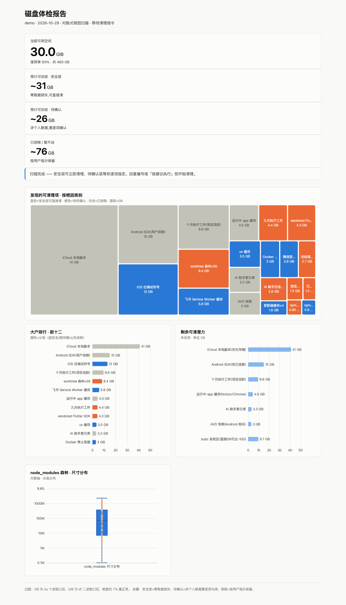
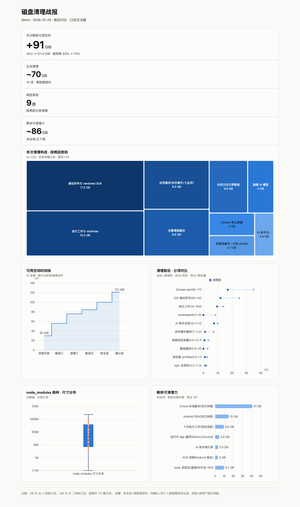

# Disk Root-Cause Clean — 磁盘根因式深挖清理 Skill

> 让你的 AI 助手（Claude Code / Codex / Cursor / 任何支持 SKILL.md 的 Agent）做一次**真正找到根因**的磁盘大清理——不是又一个"清清缓存"的敷衍脚本。

**支持 macOS 与 Windows。**

## 为什么你需要它

磁盘又满了。你让 AI 清理，它删了几个缓存文件夹，回收了 2G，过两周又满——因为它只清了**看得见的东西**。

这个 Skill 教会 Agent 一套实战验证过的方法：**对账式挖掘**——每个 GB 都要能解释出处，父目录大小对不上子项之和，就说明真正的黑洞藏在隐藏目录里。

在一台 460GB 的开发机上实测：磁盘使用率 **93% → 72%，累计回收 91GB**。挖出的典型根因：

| 根因 | 大小 | 为什么常规清理扫不到 |
|---|---|---|
| 执行产物按日期堆积（隐藏目录） | 14G | `dir/*` 通配不显示点开头目录 |
| worktree 工作区森林 | 8.4G | 分散在各项目 `.worktrees/` |
| AI 助手会话历史无限增长 | 10G | 藏在 `~/.codex` 类隐藏目录 |
| 浏览器自动下载的端侧 AI 模型 | 4G | Chrome profile 深处 |
| 进程失控日志（单文件） | 1G+ | 删除不释放空间（被进程持有） |
| 项目内嵌完整 SDK | 3.6G | 项目本体只有 83M |
| 120 个 node_modules | 18.7G | 分散全盘，无人统计 |

## 清理过程长这样（两段式报告）

清理不靠 Agent 的零散文字汇报，全程只出两份可视化报告，前后对照：

### ① 体检报告 — 扫描完、动手前

磁盘现状 KPI、三层发现（安全/待确认/排除）按色分层、大户排行、剩余潜力。看一眼就知道哪些能无脑清、哪些要确认、哪些被排除。



### ② 清理战报 — 清完验证后

释放总量、可用空间时间线、清理构成、前后对比、剩余潜力。



> 两份报告由 `scripts/make_report.py` 从真实扫描数据生成（数据样例见 `examples/`，演示图即为脱敏样例渲染），可离线运行、无外部依赖。

## 安装

**方式一：git clone（通用，任何 Agent）**

```bash
git clone https://github.com/jiyangnan/disk-root-cause-clean.git ~/.claude/skills/disk-root-cause-clean
```

Claude Code 用户装到 `~/.claude/skills/`；通用 Agent 生态（Codex / Gemini CLI / Cursor / Copilot 等）装到 `~/.agents/skills/`；其余 Agent 按各自 skills 目录约定。

**方式二：仅复制文件**

核心方法论零依赖、零脚本、零网络请求。仅 `SKILL.md` + `references/` 即可运行；`scripts/` 与 `examples/` 是报告增强，按需复制。

## 使用

装好后对你的 Agent 说：

> 我的 Mac/Windows 磁盘快满了，帮我做一次根因式深度清理

Agent 会按 Skill 的七步法执行：基线 → 盲区扫描 → 对账 → 森林统计 → 模式匹配 → 分层清理 → 验证，并在两个时机给出上面的报告。

## 安全纪律（内置，不可绕过）

清理类工具最大的风险是删掉用户的工作。本 Skill 内置四道安全门：

1. **删除前验证**：worktree/工作区逐个检查未提交更改，有未提交一律跳过单报——绝不让用户的工作白做
2. **时间边界保新**：会话/历史类只删旧的，最近一个完整周期无条件保留
3. **分层执行**：零损失项才自动执行；涉及个人数据（登录态/会话史/项目工件）列编号清单等用户逐项勾选
4. **权限拦截即拆分**：组合删除命令被安全系统拦截时拆成单目命令，更可审查；仍被拦则交用户决定

## 仓库结构

```
disk-root-cause-clean/
├── SKILL.md                 # 核心方法论：对账式挖掘七步法 + 十类根因模式库 + 执行纪律
├── references/
│   ├── macos.md             # macOS 路径与命令（实战验证版）
│   └── windows.md           # Windows 路径与命令（知识构建版，标注未实测边界）
├── scripts/make_report.py   # 两段式报告 HTML 生成器（离线，无外部依赖）
├── examples/                # 报告数据样例（脱敏演示数据）
└── docs/                    # README 用报告截图
```

## 平台支持说明

- **macOS**：`references/macos.md`，全部命令经两轮实战验证（91GB 战果即出自它）
- **Windows**：`references/windows.md`，覆盖 Win10/11 特有根因（hiberfil.sys、WinSxS、WSL2/Docker 的 vhdx 膨胀、Windows.old、Installer 缓存等），基于通用知识构建，标注了未实测边界

## Changelog

- **v1.1** — 新增两段式报告（体检报告 + 清理战报）与 HTML 生成器；README 图文丰富化
- **v1.0** — 跨平台结构（核心方法论 + macOS/Windows 双平台参考）、四道安全门、十类根因模式库

## License

MIT
